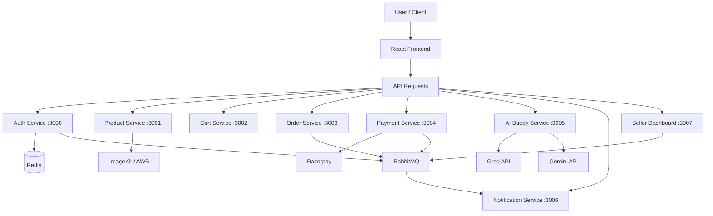

# 🛒 Online Marketplace – MERN Stack Microservices Platform

A scalable, full-stack **Online Marketplace** built using the MERN Stack and Microservices Architecture. The platform provides a complete e-commerce experience with independent backend services for authentication, products, cart, orders, payments, AI-powered product discovery, seller management, and notifications.

The project focuses on modular backend architecture, service-to-service communication, secure authentication, cloud deployment, and AI integration.

**Repository:** [Sonunapit/online-marketplace-microservices](https://github.com/Sonunapit/online-marketplace-microservices)

**Live Application:** [Online Marketplace](https://online-marketplace-microservices-frontend.onrender.com)

---

## 🚀 Key Features

- **User Authentication:** Secure registration, login, logout, JWT-based authentication, and user profile management.
- **Address Management:** Add, retrieve, and delete user delivery addresses.
- **Product Management:** Create, retrieve, update, and delete products.
- **Role-Based Access Control:** Separate permissions for users, sellers, and administrators.
- **Shopping Cart:** Add products, update quantities, remove items, and clear the cart.
- **Order Management:** Place orders, view order history, cancel orders, and update delivery addresses.
- **Online Payments:** Integrated Razorpay payment gateway with payment verification.
- **AI Product Discovery:** AI-powered product suggestions and product search assistance.
- **Seller Dashboard:** Dedicated seller dashboard for managing products, orders, and business activities.
- **Notification System:** Asynchronous notification handling using RabbitMQ.
- **Image Management:** Product image uploading and management using ImageKit and AWS services.
- **Progressive Web App (PWA):** Installable application with PWA support.
- **Automated Testing:** Backend API testing using Jest and Supertest.

---

## 🏗️ System Architecture

The application follows a **Microservices Architecture**, where every major business functionality runs as an independent service.

Each service has its own backend structure, controllers, routes, models, and database connection where applicable.

### Architecture Overview



### Microservices and Ports

| Service | Port | Responsibility |
|---|---:|---|
| Auth Service | 3000 | Authentication, users, addresses |
| Product Service | 3001 | Product CRUD and image management |
| Cart Service | 3002 | Shopping cart management |
| Order Service | 3003 | Order creation and management |
| Payment Service | 3004 | Razorpay integration |
| AI Buddy Service | 3005 | AI product discovery and suggestions |
| Notification Service | 3006 | Notifications and email |
| Seller Dashboard | 3007 | Seller management and dashboard |

---

## 🧰 Technology Stack

### Frontend
- React.js
- JavaScript
- Tailwind CSS
- Axios
- React Router
- Progressive Web App (PWA)
- Vite

### Backend
- Node.js
- Express.js
- MongoDB
- Mongoose
- REST APIs
- JWT Authentication
- Role-Based Authorization
- Multer

### Messaging & Caching
- Redis – Caching and supporting authentication workflows.
- RabbitMQ – Asynchronous messaging and inter-service communication.

### AI Integration
- Groq API
- Google Gemini API
- AI-powered product search and recommendations.

### Cloud & Storage
- ImageKit – Image uploading and management.
- AWS EC2 – Virtual server infrastructure.
- AWS ECS – Container orchestration.
- AWS ECR – Docker image registry.
- Render – Backend and frontend hosting.
- Vercel – Deployment of selected backend services.

### Payment Gateway
- Razorpay

### Testing
- Jest
- Supertest
- API integration testing

### Development & Deployment
- Git
- GitHub
- Docker
- Dockerfile
- Environment Variables
- Vercel
- Render

---

## 📂 Project Structure

```text
online-marketplace-microservices/
│
├── ai-buddy/
│   └── src/
│       ├── agent/
│       │   ├── agent.js
│       │   └── tools.js
│       ├── sockets/
│       │   └── socket.server.js
│       ├── app.js
│       └── server.js
│
├── auth/
│   ├── src/
│   │   ├── broker/
│   │   ├── controllers/
│   │   ├── db/
│   │   ├── middlewares/
│   │   ├── models/
│   │   ├── routes/
│   │   ├── tests/
│   │   └── app.js
│   ├── Dockerfile
│   ├── jest.setup.js
│   └── server.js
│
├── cart/
│   ├── src/
│   │   ├── controllers/
│   │   ├── db/
│   │   ├── middlewares/
│   │   ├── models/
│   │   ├── routes/
│   │   └── app.js
│   ├── tests/
│   ├── Dockerfile
│   └── server.js
│
├── order/
│   ├── src/
│   │   ├── controllers/
│   │   ├── db/
│   │   ├── middlewares/
│   │   ├── models/
│   │   ├── routes/
│   │   └── app.js
│   ├── tests/
│   ├── Dockerfile
│   └── server.js
│
├── payment/
│   ├── src/
│   │   ├── broker/
│   │   ├── controllers/
│   │   ├── db/
│   │   ├── middlewares/
│   │   ├── models/
│   │   ├── routes/
│   │   └── app.js
│   └── server.js
│
├── notification/
│   └── src/
│       ├── broker/
│       │   ├── broker.js
│       │   └── listeners.js
│       ├── app.js
│       └── email.js
│
├── product/
│   ├── src/
│   │   ├── controllers/
│   │   ├── db/
│   │   ├── middlewares/
│   │   ├── models/
│   │   ├── routes/
│   │   ├── services/
│   │   ├── validators/
│   │   └── app.js
│   ├── tests/
│   ├── Dockerfile
│   └── server.js
│
├── seller-dashboard/
│   ├── src/
│   │   ├── broker/
│   │   ├── controllers/
│   │   ├── db/
│   │   ├── middlewares/
│   │   ├── models/
│   │   ├── routes/
│   │   └── app.js
│   └── server.js
│
├── frontend/
│   ├── public/
│   ├── src/
│   │   ├── api/
│   │   ├── assets/
│   │   ├── components/
│   │   ├── features/
│   │   ├── pages/
│   │   ├── routes/
│   │   ├── utils/
│   │   ├── App.jsx
│   │   └── main.jsx
│   ├── package.json
│   └── vite.config.js
│
└── .gitignore
```

---

## 🔐 Authentication Service – Port 3000

The authentication service handles user registration, login, logout, JWT authentication, and address management.

### API Endpoints

| Method | Endpoint | Description |
|---|---|---|
| POST | `/api/register` | Register a new user |
| POST | `/api/login` | User login |
| GET | `/api/me` | Get authenticated user |
| GET | `/api/logout` | Logout user |
| GET | `/api/users/me/addresses` | Get user addresses |
| POST | `/api/users/me/addresses` | Add a new address |
| DELETE | `/api/users/me/addresses/:addressId` | Delete an address |

**Additional Technologies:** Redis, JWT, Express Validator, MongoDB, RabbitMQ.

---

## 📦 Product Service – Port 3001

Handles product-related operations, seller product management, validation, and image uploading.

### API Endpoints

| Method | Endpoint | Description |
|---|---|---|
| POST | `/api/` | Create a product |
| GET | `/api/` | Get all products |
| GET | `/api/:id` | Get product by ID |
| GET | `/api/seller` | Get seller products |
| PATCH | `/api/:id` | Update a product |
| DELETE | `/api/:id` | Delete a product |

**Additional Technologies:** Multer, ImageKit, AWS, Role-Based Authorization.

---

## 🛒 Cart Service – Port 3002

Provides shopping cart functionality for authenticated users.

### API Endpoints

| Method | Endpoint | Description |
|---|---|---|
| GET | `/api/` | Get cart |
| POST | `/api/items` | Add item to cart |
| PATCH | `/api/items/:productId` | Update item quantity |
| DELETE | `/api/items/:productId` | Remove an item |
| DELETE | `/api/` | Clear cart |

---

## 📋 Order Service – Port 3003

Manages the complete order lifecycle.

### API Endpoints

| Method | Endpoint | Description |
|---|---|---|
| POST | `/api/orders/` | Create an order |
| GET | `/api/orders/me` | Get my orders |
| GET | `/api/orders/:id` | Get order details |
| POST | `/api/orders/:id/cancel` | Cancel an order |
| PATCH | `/api/orders/orders/:id/address` | Update delivery address |

---

## 💳 Payment Service – Port 3004

Integrated with Razorpay for online payments.

### API Endpoints

| Method | Endpoint | Description |
|---|---|---|
| POST | `/api/create/:orderId` | Create a payment |
| POST | `/api/verify` | Verify payment |

**Payment Flow:**
1. User places an order.
2. Backend creates a Razorpay payment order.
3. User completes payment through Razorpay.
4. Frontend submits payment verification details.
5. Backend verifies the payment.
6. Order and payment status are updated.

---

## 🤖 AI Buddy Service – Port 3005

An AI-powered shopping assistant that helps users discover products and get intelligent product suggestions.

### Features
- AI-powered product search assistance.
- Intelligent product recommendations.
- Natural-language shopping queries.
- AI agent architecture.
- Tool-based AI interactions.
- Real-time communication using Socket.IO.

**AI Technologies:** Groq API and Google Gemini API.

---

## 🔔 Notification Service – Port 3006

Handles asynchronous notification processing and email-related operations.

### Features
- RabbitMQ message consumption.
- Event-driven notification processing.
- Email notification integration.
- Independent notification service.

---

## 📊 Seller Dashboard – Port 3007

Provides dedicated seller management functionality.

### Features
- Seller authentication and authorization.
- Seller dashboard APIs.
- Product information management.
- Order and payment data handling.
- RabbitMQ-based communication.
- Independent seller-side backend.

---

## 🔄 Inter-Service Communication

The platform uses RabbitMQ for asynchronous communication between independent backend services.

**Benefits:**
- Decoupled services.
- Asynchronous event processing.
- Better separation of business responsibilities.
- Easier service-level scalability.

Redis is also used in the authentication service for caching and supporting authentication workflows.

---

## ☁️ Cloud Deployment & Infrastructure

Initially, I explored AWS infrastructure for deploying the microservices architecture.

### AWS Technologies Explored
- AWS EC2 – Virtual machine infrastructure.
- AWS ECS – Container management.
- AWS ECR – Docker image storage and registry.

Due to the expiration of the available AWS free-tier/trial resources, I moved the deployment to Render and Vercel.

### Current Deployment

| Component | Deployment |
|---|---|
| Frontend | Render |
| Auth Service | Render |
| Product Service | Render |
| Cart Service | Render |
| Order Service | Vercel |
| Payment Service | Vercel |
| AI Buddy Service | Vercel |
| Seller Dashboard | Vercel |
| Notification Service | Local / separate deployment not listed |

### Live URLs

| Service | URL |
|---|---|
| Frontend | [Open Application](https://online-marketplace-microservices-frontend.onrender.com) |
| Auth | [Auth Service](https://online-marketplace-microservices.onrender.com) |
| Product | [Product Service](https://online-marketplace-microservices-1.onrender.com) |
| Cart | [Cart Service](https://online-marketplace-microservices-cart.onrender.com) |
| Order | [Order Service](https://online-marketplace-microservices-or.vercel.app) |
| Payment | [Payment Service](https://online-marketplace-microservices-pa.vercel.app) |
| AI Buddy | [AI Service](https://online-marketplace-microservices-ai.vercel.app) |
| Seller Dashboard | [Seller Service](https://online-marketplace-microservices-se.vercel.app) |

---

## 📱 Progressive Web App (PWA)

The frontend supports Progressive Web App functionality.

- Installable on supported devices.
- Web app manifest configuration.
- Custom application icons.
- Improved installation experience.
- PWA update support using Vite PWA.

---

## 🧪 Testing

Backend services include automated tests using Jest and Supertest.

Test coverage includes:

**Authentication Service**
- User registration.
- User login.
- User logout.
- Get current user.
- Address management.

**Product Service**
- Create products.
- Get products.
- Update products.
- Delete products.

**Cart Service**
- Get cart.
- Add cart items.
- Update item quantity.
- Remove items.

**Order Service**
- Create orders.
- Get orders.
- Get order by ID.
- Cancel orders.
- Address management.

Run tests from an individual service directory:

```bash
npm test
```

---

## ⚙️ Environment Variables

Each microservice maintains its own `.env` configuration.

The following environment variable names are used across the project, depending on the service:

```env
# Database
MONGO_URI=

# Authentication
JWT_SECRET=
REFRESH_TOKEN=

# Redis
REDIS_HOST=
REDIS_PORT=
REDIS_PASSWORD=

# RabbitMQ
RABBIT_URL=

# Email
EMAIL_USER=

# OAuth (where applicable)
CLIENT_ID=
CLIENT_SECRET=

# AI Integration
GROQ_API_KEY=
GEMINI_API_KEY=

# Image Storage
IMAGEKIT_PUBLIC_KEY=
IMAGEKIT_PRIVATE_KEY=
IMAGEKIT_URL_ENDPOINT=

# Payment Gateway
RAZORPAY_KEY_ID=
RAZORPAY_KEY_SECRET=

# Frontend
CLIENT_URL=
```

**Security:** Never commit `.env` files, database credentials, JWT secrets, API keys, or payment credentials to GitHub. Configure environment variables through your deployment provider.

---

## 💻 Local Development Setup

### 1. Clone Repository

```bash
git clone https://github.com/Sonunapit/online-marketplace-microservices.git

cd online-marketplace-microservices
```

### 2. Install Dependencies

Install dependencies separately in each service:

```bash
cd auth
npm install
```

Repeat for:

```text
product/
cart/
order/
payment/
ai-buddy/
notification/
seller-dashboard/
frontend/
```

### 3. Configure Environment Variables

Create a `.env` file inside each service directory and configure the required database, Redis, RabbitMQ, JWT, AI, payment, and storage credentials.

### 4. Start Backend Services

Run each microservice independently:

```bash
npm start
```

Use the corresponding service directory and start command defined in its `package.json`.

### 5. Start Frontend

```bash
cd frontend
npm install
npm run dev
```

Open:

```text
http://localhost:5173
```

---

## 🎯 What I Learned From This Project

Building this project helped me understand and implement:

- Real-world Microservices Architecture.
- Designing independent Node.js and Express services.
- REST API development and integration.
- JWT-based authentication and authorization.
- Redis caching concepts.
- RabbitMQ message brokering.
- MongoDB and Mongoose.
- AI integration using Groq and Gemini.
- AI agent and tool-based architecture.
- Razorpay payment integration.
- ImageKit and AWS storage workflows.
- Docker and AWS deployment technologies.
- Cloud deployment using Render and Vercel.
- Automated backend testing with Jest and Supertest.
- Progressive Web App development.
- Managing multiple backend services in a single GitHub repository.

---

## 👨‍💻 Developer

**Sonu Kumar Napit**

BCA Student | Full Stack Developer | MERN Stack | Microservices | AI Integration

- GitHub: [@Sonunapit](https://github.com/Sonunapit)
- LinkedIn: [Sonu Kumar Napit](https://www.linkedin.com/in/sonu-kumar-napit-988a152a1/)

---

⭐ If you find this project interesting, consider giving the repository a star!

**Built with ❤️ using MERN Stack, Microservices Architecture, and AI.**
